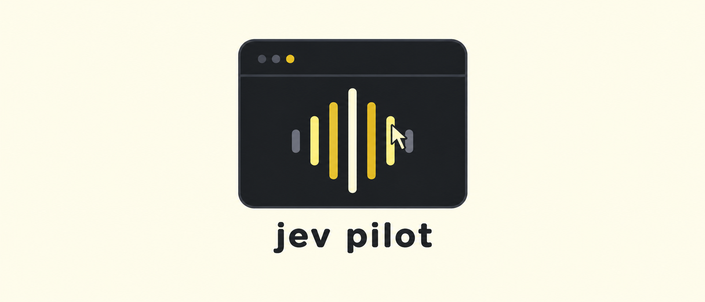
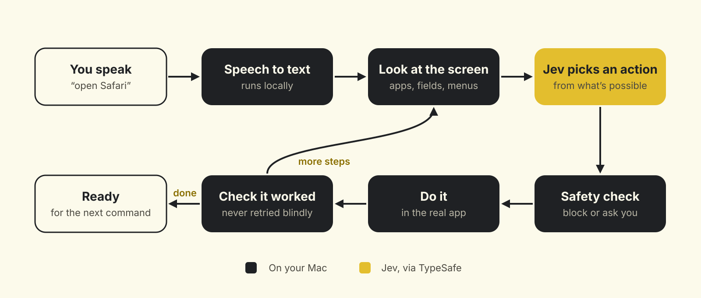

# Jev Pilot

<p align="center">
  
</p>

Control your Mac with spoken commands. Jev Pilot listens through your microphone, transcribes speech locally, asks Jev to choose a grounded action, and checks the result before continuing.

This early macOS command-line release is designed for short, explicit commands. Start listening in Terminal, speak commands in the apps you want to control, and keep talking while the session remains open.

## What you can do

- Open or switch to installed apps, including familiar names such as Chrome and VS Code.
- Visit websites and search Google or YouTube, including in a named browser.
- Dictate into the focused text field and explicitly ask to press Enter.
- Create a note in Apple Notes or a document in TextEdit, then dictate its contents.
- Copy, cut, paste, undo, and redo in text fields.
- Delete the word before the caret, insert a new paragraph, and select all text.
- Click uniquely named Safari links and buttons; duplicate names need a more specific request.
- Open, switch, and close browser tabs; go back or forward; reload; zoom in, out, or reset.
- Scroll up or down, or jump to the top or bottom of a page.
- Search in Finder and scroll Finder's file list.
- Enter full screen or minimize the current window or a named running app.
- Run multiple commands in one listening session.

More complex workflows can stop when Jev Pilot cannot find or verify a required control.

## Install

You need an Apple Silicon Mac, [uv](https://docs.astral.sh/uv/getting-started/installation/), and a TypeSafe account with a Jev API key. Internet access is needed for Jev decisions and the initial speech-model download. Speech transcription runs locally after the model is cached.

After `jvpilot` is published to PyPI, install it with:

```sh
uv tool install --python 3.12 jvpilot
uv tool update-shell
```

Restart Terminal if needed for the `jvpilot` command to appear on your PATH. To install from a source checkout, see [Local development](#local-development).

The first listening run downloads the Nemotron speech model automatically if it is not already cached. This can take several minutes. Later runs reuse the cached model.

Create the configuration directory:

```sh
mkdir -p "$HOME/Library/Application Support/Jev Pilot"
```

Create `~/Library/Application Support/Jev Pilot/.env` with your key:

```text
TYPESAFE_API_KEY=your_key_here
```

Keep this file private. You can also set `TYPESAFE_API_KEY` in your shell. The environment variable takes precedence, followed by a source checkout's `.env`, then the user configuration file above. Installed use does not load `.env` files from the current directory or `site-packages`.

## Grant macOS permissions

Allow **Microphone** access for the Terminal/Python host macOS identifies when you first listen. If access was denied, check **System Settings → Privacy & Security → Microphone**.

Desktop controls also need **Accessibility** access. Request it with:

```sh
jvpilot --request-accessibility
```

Enable the identified host under **System Settings → Privacy & Security → Accessibility**. Restart that host if needed, then rerun the command until it reports `accessibility_trusted: true`. Opening or switching apps alone does not require Accessibility; most other controls do.

## Start and stop listening

In Terminal, start a session with:

```sh
jvpilot --listen --auto-approve-basic
```

This skips routine confidence prompts for app opening/switching, website navigation, and Google/YouTube searches. Other approvals and safety checks stay active. Run `jvpilot --listen` to keep those routine prompts too.

To skip routine confidence prompts for other supported commands as well, use:

```sh
jvpilot --listen --yes
```

These commands always require approval, even with `--yes`: cutting text, closing a tab in browsers other than Safari, pressing Enter outside Notes or TextEdit, and pressing a control you didn't name. Opening and closing Safari tabs never ask. When you ask to click a named control, such as “click the ESPN video,” it is pressed without asking, unless its label sends or commits something, such as Send, Submit, Pay, Checkout, or Sign out. Existing safety blocks and target/result checks remain active; password, payment, purchase, and deletion requests are blocked.

Then:

1. Say a command, such as **“open Safari.”**
2. Pause briefly so Jev Pilot can finish the utterance. The default pause is about 650 ms.
3. Wait for **“Ready for the next command.”**
4. Say another command without restarting the listener.

To control when an utterance starts and ends, run `jvpilot --listen --push-to-talk`. Hold **Right Option** while speaking and release it to finish. An Option shortcut cancels that utterance. Enable **Input Monitoring** for your terminal under **System Settings → Privacy & Security → Input Monitoring** if prompted, then restart the terminal. The same flag works with `--transcribe-only`.

`jvpilot --listen --draft` lets Jev start choosing an action during a pause. The listener waits for the exact final transcript and rechecks the target before acting. Use `--no-draft` to compare with decisions made after transcription.

A floating panel shows the transcript, action progress, result, and approval state without taking keyboard focus. Use `--no-status` for Terminal-only feedback.

If a `Y / n` prompt appears, enter `y` to approve or `n` to decline. After a command fails or is declined, the listener normally stays active; speak a fresh command after the result. Queued follow-up commands behind a failure are discarded.

Stop by saying **“stop listening,” “stop pilot,”** or **“quit pilot.”** You can also press **Control-C** in Terminal. Stopping cancels pending work before its next action; it cannot undo an action already sent. Run the start command again for a new session.

## Example commands

| What you want | Say |
|---|---|
| Open an installed app | “open Cursor” · “open Notes” · “open Music” |
| Switch apps | “switch to Chrome” · “switch to Finder” |
| Visit a website | “go to YouTube” · “go to stripe dot com” |
| Choose a browser | “open example.com in Chrome” |
| Search Google | “google best ramen near me” |
| Search YouTube | “search for Messi soccer videos on YouTube” |
| Search in a named browser | “search YouTube for lofi hip hop in Safari” |
| Dictate into the focused field | “type hello world” |
| Dictate, then press Enter | “type hello world and hit enter” |
| Create and fill a note | “create a new note in Notes and type hello world” |
| Create and fill a document | “create a new document in TextEdit and type hello world” |
| Select text | “select all” |
| Edit text by voice | “delete the last word” · “new paragraph” |
| Click in Safari | “click Downloads” · “click Show details” |
| Edit with the clipboard | “copy” · “cut” · “paste” |
| Undo or redo | “undo” · “redo” |
| Browser tabs | “open a new tab” · “go to the next tab” · “go to the previous tab” · “switch to the GitHub tab” · “close this tab” |
| Browser history | “go back” · “go forward” · “reload the page” |
| Zoom a page | “zoom in” · “zoom out” · “reset zoom” |
| Scroll | “scroll down” · “scroll up a lot” · “scroll to the top” · “scroll to the bottom” |
| Search in Finder | “search Finder for invoices” |
| Enter full screen | “maximize this window” · “maximize Safari” |
| Minimize a window | “minimize this window” · “minimize Safari” |
| Stop the session | “stop listening” |

Text commands need an editable field; select-all also needs existing text. Typing inserts at the caret or replaces selected text. “Maximize” means enter full screen. Use short, explicit requests and name the app for document workflows. If a command is misheard, wait for its result and speak a fresh instruction; completed actions are not automatically undone.

“Delete the last word” removes the word immediately before a collapsed caret, including trailing spaces, while preserving text after it. It requires native text-replacement and selection support. “New paragraph” inserts two line breaks in a writable multiline editor. Named Safari clicks require accessible English labels and a complete bounded scan; duplicate or unavailable targets stop without clicking. Link redirects may remain unverified.

## How it works

<p align="center">
  
</p>

1. **Listen:** your speech is turned into text locally. A pause marks the end of a command.
2. **Look:** Jev Pilot reads what's on screen through macOS Accessibility, the same interface screen readers use. It sees the open apps, text fields, menus and scrollable areas.
3. **Decide:** Jev receives your command and a short list of the actions currently possible, then picks one. It can only choose from that list.
4. **Check and act:** local safety rules can block the action or ask for your approval. Jev Pilot then performs the action and confirms that the app actually changed before taking another step.

Nothing is retried blindly. If a result can't be confirmed, Jev Pilot stops and tells you. For module-level detail, see [the architecture guide](docs/ARCHITECTURE.md).

## Cost

Jev Pilot itself is free, and speech transcription on your Mac costs nothing. The only cost is TypeSafe's charge for Jev decisions, which is based on input tokens (the text sent to Jev).

In a 31-command test session, each command made 2–4 Jev calls and used about 9,800 input tokens on average. Simple commands such as "Open Notes" used about 8,000, and two-step commands such as "create a new document in TextEdit and type…" used about 18,500. At TypeSafe's listed rate of about $0.042 per million input tokens, with output tokens free, that works out to:

| Usage | Approximate Jev cost |
| --- | --- |
| One command | $0.0004 (about 2,400 commands per dollar) |
| 100 commands a day | $1.25 a month |
| 500 commands a day | $6 a month |

For comparison, paid plans for HeyClicky, a subscription desktop assistant, cost $20–100 a month as of November 2026. Those plans include features Jev Pilot doesn't have, such as answering questions about your screen. TypeSafe's rates can change, so check your TypeSafe account for current pricing. Each session report records the input and output tokens for every Jev call, so you can check your own usage.

## Limits and privacy

Menus must expose supported English labels. Browser tab, history, and zoom controls are tested in Safari; other browsers vary, opening tabs in Helium and other browser-specific controls remain future work. Quitting apps, creating Terminal windows, submitting Terminal commands, and choosing a Music playlist are not supported. Secure, read-only, or unreadable text fields cannot be edited.

An `unsupported` result means no suitable action was available. An `unverified` result means an action may have happened, but Jev Pilot could not confirm it. Check the app before repeating a command, especially note creation or typing.

Speech transcription runs on your Mac. Jev requests send your spoken goal and bounded app/control metadata to TypeSafe. Existing document values and clipboard contents stay local. Session reports contain transcripts and dictated text; review them before sharing.

**Do not speak passwords, API keys, access tokens, or other credentials.** Spoken goals are sent to TypeSafe and saved in local session reports; credential detection and redaction are not provided. Finder candidate filenames may be sent to TypeSafe, but their full file paths stay local unless you include a path in your spoken goal.

## Troubleshooting

- **Check speech without desktop actions:** run `jvpilot --transcribe-only`, speak a few phrases, then press Control-C. This does not call Jev or require an API key or Accessibility access.
- **Commands split too early:** increase the pause, for example `jvpilot --listen --auto-approve-basic --silence-ms 900`. Lower it for faster turn-taking.
- **Quiet speech is missed:** lower `--speech-threshold` slightly from its default `0.012`; raise it if background noise triggers utterances.
- **Desktop controls are unavailable:** check Accessibility for the same Terminal/Python host used to listen. The app must expose the relevant control or editable field.
- **An app opens but a workflow stops:** check the result before trying again. Opening, creation, focus, and typing are separate steps.
- **A command reports `unverified`:** check the app before repeating it. Scrolling needs a scrollable area that macOS Accessibility exposes, and some apps don't expose one.
- **Share a failure:** the latest session report is saved after each command to `~/Library/Application Support/Jev Pilot/Reports/python-cli-last.json`. Use `--report .build/my-session.json` to choose another path. Remove private transcript or dictation content before sharing.

## Roadmap

### Next release: everyday control

- **Click things by name:** “click Sign in” · “open the Pricing link”, for buttons and links on web pages and in apps.
- **Voice text editing:** “delete the last word” · “replace Tuesday with Wednesday” · “new paragraph” · “select the last sentence”.
- **Media and system controls:** “pause music” · “next song” · “play my Main playlist” · “volume to 30” · “turn on dark mode”.
- **Window layout:** “put Safari on the left half” · “move this window to the other screen”.
- **Quit apps and close windows:** “quit Music” · “close this window”, with approval whenever unsaved work could be lost.

### Later: multi-step commands

- **Chained requests:** “open Safari, go to GitHub, and open a new tab” as one sentence, with each step checked before the next.
- **Apple Shortcuts:** “run my Morning shortcut”.

### Ideas: voice-played games

- **Voice chess:** say “knight to f3” to play on sites with typed move entry, such as Lichess.
- **Mental-math sprints:** speak answers in Zetamac-style arithmetic drills.
- **Quiz games:** answer Sporcle or Seterra quizzes, and type Wordle guesses, by voice.
- **Desktop speedrun:** a timed built-in challenge (“open Notes, write a haiku, then search YouTube for lofi”) that teaches the commands and scores your speed and accuracy.

## Local development

The runtime is the Python CLI in `app/`. From a source checkout, use uv to create a local environment and install the project in editable mode:

```sh
uv venv --python 3.12
source .venv/bin/activate
uv pip install -e .
jvpilot --listen --auto-approve-basic
```

Jev Pilot's PyPI package and installed command are both named `jvpilot`; `python -m app` is also available. Package version and build settings live in `pyproject.toml`; dependencies are listed in `requirements.txt`.

In each new terminal, run `source .venv/bin/activate` from the checkout before starting the development CLI or running checks.

CI runs a small offline suite that uses fake apps, a fake microphone and a fake Jev. To run it locally:

```sh
uv pip install pip 'setuptools>=77' packaging pyyaml
python -m unittest discover -s tests -p 'test_*.py' -v
```

Real-app behavior is tested with the native matrix. It needs Accessibility for your terminal and a configured API key, and it calls live Jev:

```sh
python -m scripts.native_matrix --list          # show cases
python -m scripts.native_matrix                 # run every case once
python -m scripts.native_matrix --only v0.2 --repeat 3
python -m scripts.native_matrix --only latency
python -m scripts.native_matrix --only v0.3     # new editing and named-click checks
python -m scripts.native_matrix --voice         # file transcription for historical comparisons
python -m scripts.native_matrix --live-voice --draft
python -m scripts.native_matrix --live-voice --push-to-talk
```

The matrix opens its own disposable TextEdit document, Safari window and Finder folder, then checks results independently using AppleScript, page events and Accessibility reads. The latency cases move the fixture caret after Jev chooses an insertion and verify that the document stays untouched. Live voice replays synthesized speech at microphone pace and measures from the speech boundary or simulated key release to dispatch completion. The matrix saves results to `.build/native-matrix.json` and exits nonzero if a v0.1 command or latency regression case fails. Leave the Mac alone while it runs, because it moves focus between apps and overwrites your clipboard.

See [the architecture guide](docs/ARCHITECTURE.md) for implementation details. Restart the listener after changing code.

To compare a recording of your voice through file transcription, live capture, and simulated push-to-talk, use `scripts/test_stt_e2e.py` with the same `JEV_STT_AUDIO` and `JEV_STT_EXPECTED` environment values. Set `JEV_STT_MODE` to `file`, `live`, or `push_to_talk`, then run `python -m scripts.test_stt_e2e`. This calls no Jev and performs no desktop actions; its latest result is `.build/stt-e2e.json`. Simulated push-to-talk does not test your physical key or microphone.
